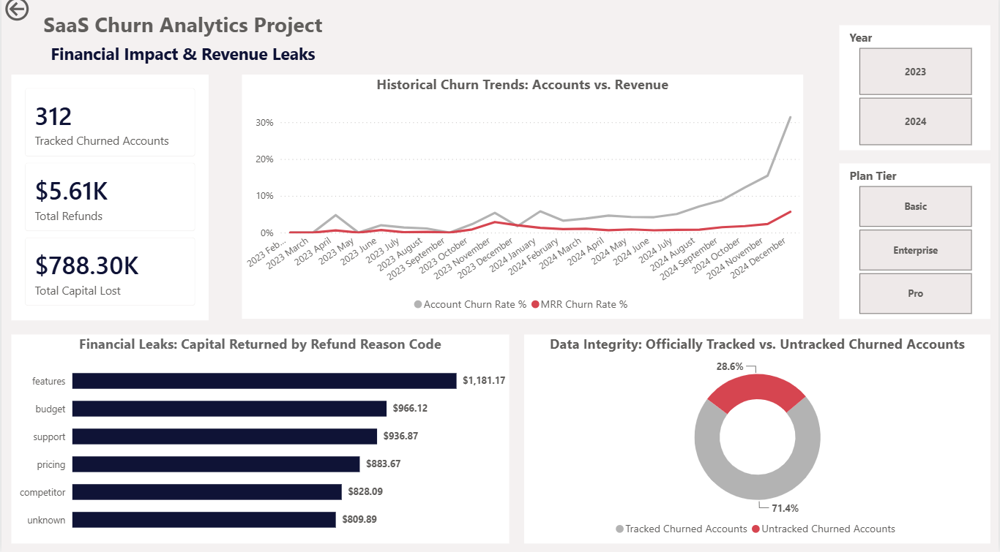

# 📊 SaaS Customer Churn & Revenue Analytics Pipeline

## 📌 Project Overview
This project builds an end-to-end ELT (Extract, Load, Transform) data pipeline and an interactive Power BI dashboard to analyze customer retention, product engagement, and support ticket friction for a B2B SaaS company. The primary business goal is to identify early warning signs of customer churn and isolate financial revenue leakage.

By applying an **ELT (Extract, Load, Transform)** framework, this project ingests raw operational data, builds a robust relational warehouse structure, runs programmatic data audits, and delivers an interactive executive semantic layer to isolate revenue leakage patterns.

---

## 📷 Dashboard Preview (Phase 1)

*Note: Due to Microsoft cloud license restrictions for independent personal developer environments, the semantic reporting layer is showcased above via high-resolution layout preview. The fully compiled development file (`.pbix`) is available in this repository for comprehensive architectural and DAX model auditing.*

---

## 🚀 Project Status & Agile Roadmap
To ensure rapid deployment and data integrity, this project is structured and delivered in sequential phases:

### ✅ [COMPLETED] Phase 1: Pipeline Architecture & Executive Revenue Analysis
*   **Database Ingestion & Schema Engineering:** Implemented an ELT workflow to ingest raw staging data into SQLite, refactoring it into a multi-fact **Galaxy Schema** with strict primary/foreign key constraints and indexing.
*   **Exploratory Data Analysis (EDA) & Data Auditing:** Developed a comprehensive SQL script to run sanity checks, data-quality audits, and baseline business queries.
*   **Semantic Layer & Dashboard Design:** Connected Power BI via ODBC, managed data types via Power Query, and engineered dynamic DAX measures to calculate monthly churn rates, revenue leaks, and untracked churned accounts.

### ⏳ [IN PROGRESS] Phase 2: Product Engagement & Feature Usage Patterns
*   **Objective:** Identify specific product feature usage degradation trends during the critical 30-day window leading up to a customer's cancellation.

### 📋 [UPCOMING] Phase 3: Customer Support Operations Impact
*   **Objective:** Correlate support ticket volume, categories, and resolution times with downstream customer retention risk thresholds.

---

## 🛠️ Technical Stack & Architecture
*   **Database / Storage:** SQLite (DB Browser) utilizing an ELT methodology.
*   **Data Modeling & Warehousing:** Relational schema design (**Galaxy Schema**), indexing, primary/foreign key constraints, and dynamic calendar table integration.
*   **Data Validation & Analytics:** SQL (Advanced scripts for EDA, database auditing, and sanity checks).
*   **BI & Data Modeling:** Power BI Desktop (Power Query for type casting, Galaxy semantic modeling).
*   **Analytics Logic:** Advanced DAX (Context transition manipulation and dynamic variables).

---

## 📂 The Dataset & Repository Structure
The project analyzes data across 2023 and 2024 spanning 6 core relational tables:
1.  **dim_calendar:** A custom-generated continuous date dimensions matrix.
2.  **dim_accounts:** Core B2B customer firmographic profiles and status flags.
3.  **fact_subscriptions:** Historical log of financial milestones, plan tiers, and MRR tracking.
4.  **fact_churn_events:** Granular cancellation data mapping churn reasons and financial impacts.
5.  **fact_feature_usage:** Daily product application logs tracking feature-level engagement.
6.  **fact_support_tickets:** Customer success logs tracking ticket volume and resolution statuses.

*The production SQL analysis scripts can be reviewed in the `/sql-scripts` directory.*

---

## ⚙️ Data Engineering & Modeling Best Practices Applied

🔍 Click to view Database Engineering Details (SQL & Schema)

*   **ELT Methodology:** Ingested raw Kaggle datasets directly into decoupled staging tables before migrating them into structured target production tables to preserve the raw data lineage.
*   **Performance Optimization (Indexing):** Implemented database indexes on high-frequency join columns (such as customer IDs and dates) to minimize query execution times during EDA.
*   **Galaxy Schema Layout:** Configured multiple independent fact tables sharing conformed dimension tables to avoid data redundancy and maintain single-direction cross-filtering.
*   **Data Quality Auditing:** Created a dedicated SQL script containing programmatic "sanity check" queries to audit structural constraints, and validate database integrity prior to BI connection.

🔍 Click to view BI Semantic Layer Details (Power BI & DAX)

*   **Decoupled Calculations:** Kept the backend lightweight by consuming the structured relational tables directly via an ODBC link, allowing Power BI to focus strictly on semantic rendering and live business logic.
*   **Memory Efficiency:** Strictly utilized dynamic DAX Measures over Calculated Columns to ensure minimum RAM consumption and rapid visual rendering.
*   **Clean Code Standards:** All DAX expressions are fully documented with inline comments (`//`) to facilitate technical auditing, code hand-offs, and future query refactoring.

---

## 💡 Key Business Insights Delivered (Phase 1)
1.  **Account vs. Revenue Churn Divergence:** Tracks the correlation between total subscription cancellations and actual MRR impact to identify if high-value enterprise accounts are churn risk priorities.
2.  **Financial Friction & Operational Auditing:** Isolates specific churn reason codes paired with their financial refund weight to pinpoint exactly which product or service issues cost the business the most revenue.
3.  **Data Governance & Ingestion Health:** Provides an operational audit of logging consistency, mapping tracked user profiles against missing transactional history to ensure absolute data model integrity.

---

## 📂 Repository Structure
*   `/sql_scripts`: Contains production SQL scripts for EDA, data quality audits, and business query testing.
*   `/power_bi`: The `.pbix` file ready for architectural review.
*   `README.md`: Project documentation and roadmap.
